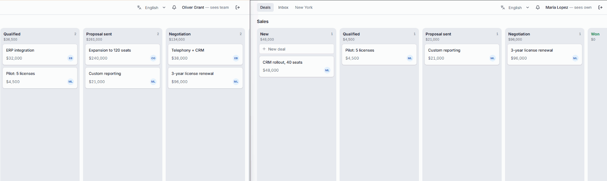
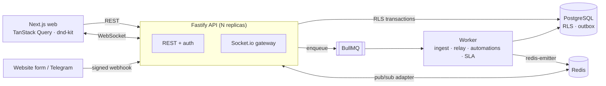

# Lead-to-Deal Engine

[](https://github.com/Embox99/nextjs-fastify-crm/actions/workflows/ci.yml)

**A multi-tenant B2B CRM with a realtime kanban, an omnichannel inbox and an event-driven automation engine.**

Built as a production-style reference for the hard parts of a SaaS backend: tenant isolation enforced by the database,
concurrency-safe ordering, idempotent webhook ingestion, and background pipelines with exactly-once effects.

`Next.js 16` · `Fastify 5` · `PostgreSQL 17 + Row Level Security` · `Drizzle ORM` · `Redis` · `BullMQ` · `Socket.io` · `TypeScript` · `Turborepo`



*The same board seen by a team lead (left) and a sales rep (right): moves sync instantly across users,
and each user sees only the deals they are allowed to see.*

---

## Features

- **Realtime kanban** — drag-and-drop deals with optimistic updates, live sync across users and server replicas,
  presence ("who is viewing") and soft locks ("Maria is editing").
- **Role-based visibility** — admins see everything, team leads see their team (including sub-teams), reps see only their deals.
  Enforced by PostgreSQL RLS, not by `WHERE` clauses in endpoints.
- **Lead ingestion** — signed webhooks from a website form (HMAC) and a Telegram bot, deduplicated into contacts by phone,
  email and Telegram ID. Returns `202` immediately; processing happens in a queue.
- **Omnichannel inbox** — conversations per channel, replies delivered to Telegram, delivery status in realtime.
- **Automation engine** — "When / If / Then" rules built in the UI:
  - triggers: *new lead*, *deal moved to stage*, *SLA breached in stage*, *no activity for N days*;
  - conditions: a typed AST (`all` / `any` / `not`, `deal.value > 10000`, …);
  - actions: *assign a manager (round-robin)*, *create a task*, *send a notification*.
- **Board administration** — add, rename, reorder and delete columns (deals are moved to another column), per-column SLA.
- **Notifications** with deep links, tasks on deals, English and Russian UI.

## Architecture



| Package | Responsibility |
|---|---|
| `apps/api` | Fastify REST API, Socket.io gateway, webhooks, auth |
| `apps/worker` | BullMQ processors: lead ingestion, Telegram delivery, outbox relay, automation matcher and executor, SLA checks, stale-deal scanner, column rebalancing |
| `apps/web` | Next.js App Router UI: board, inbox, automation builder |
| `packages/db` | Drizzle schema, SQL migrations with RLS policies, `withRls()`, demo seed |
| `packages/domain` | Pure logic: fractional ranking, visibility rules, condition evaluation, round-robin |
| `packages/contracts` | Zod schemas and typed Socket.io events shared by all apps |
| `packages/realtime` | One event publisher for both the API (Socket.io) and the worker (Redis emitter) |

## Engineering highlights

**Tenant isolation in the database.** Every request runs in a transaction that sets the user's context with
`set_config(..., true)`. RLS policies turn it into predicates, so a forgotten filter cannot leak data. The app role has
no `BYPASSRLS`, tables use `FORCE ROW LEVEL SECURITY`, and a test fails if any tenant table is left without a policy.
Policy helpers are written so the planner inlines them (verified with `EXPLAIN` in tests). Composite foreign keys
(`(workspace_id, contact_id)`) prevent references across tenants, which RLS alone does not cover.

**Ordering without rewriting columns.** Card and column positions use fractional indexing: a move is a single-row
`UPDATE`. The client sends neighbour IDs instead of a key, so a stale client cannot corrupt the order. Equal keys from
concurrent inserts are handled, and long keys trigger a background rebalance.

**Webhooks that never lose or duplicate a lead.** Signatures are verified against raw bytes, with timestamp tolerance
and key rotation. Duplicates are filtered in Redis, with a unique constraint in PostgreSQL as the source of truth.
The raw event is stored before any processing, and a sweeper re-enqueues events lost between commit and enqueue.
Concurrent leads with the same phone are serialized with advisory locks; conflicting identities create a merge
candidate instead of a silent merge.

**Automations with exactly-once effects.** Domain events are written to a transactional outbox in the same
transaction as the change. A relay publishes them with `FOR UPDATE SKIP LOCKED` and rolls back the claim if enqueueing
fails. Each automation run executes its actions in order, committing every action together with its progress, so a
retry resumes where it stopped. Round-robin assignment reserves the manager in a short separate transaction: in an
earlier version, holding the hot pool lock together with the deal lock stalled ingestion under load (queue drain
16.4 s → 3.5–5.7 s in the burst test). SLA checks are delayed jobs that compare the stage-entry timestamp when they
fire, so a deal that moved on is simply ignored.

**Realtime that respects permissions.** Socket.io rooms mirror the visibility model (workspace / team / user), so an
event reaches exactly the users who can see the row. When a deal is reassigned, the previous owner receives
`deal.removed`. The Redis adapter delivers events across API replicas.

## Getting started

Requirements: Node.js 24+, Docker, pnpm (`corepack enable`).

```bash
pnpm install
cp .env.example .env     # set JWT_SECRET (32+ chars) and SECRETS_KEY (32 bytes, base64)
pnpm db:up               # PostgreSQL on :5434, Redis on :6380
pnpm db:migrate
pnpm db:seed             # demo organization "acme"
pnpm dev                 # API :4000, worker (health :4001), web :3000
```

Generate `SECRETS_KEY` with:

```bash
node -e "console.log(require('crypto').randomBytes(32).toString('base64'))"
```

Open http://localhost:3000 and sign in with organization `acme`, password `demo`:

| User | Role | Sees |
|---|---|---|
| `admin@acme.test` | Admin | Everything, plus automations and column settings |
| `lead@acme.test` | Team lead | Deals and conversations of the Enterprise team |
| `rep1@acme.test`, `rep2@acme.test` | Sales reps (Enterprise) | Only their own deals |
| `rep3@acme.test` | Sales rep (SMB) | Only their own deals |

### Things to try

- **Realtime:** open the board as two different users in two browser profiles (the session is shared between tabs of
  one profile). Moves and the "is editing" badge appear without reloading.
- **Lead ingestion:** send a signed webhook. The lead lands in the inbox and on the board, the demo automation assigns
  it round-robin and notifies the manager.

  ```bash
  pnpm --filter @crm/api demo:lead
  pnpm --filter @crm/api demo:lead telegram "Hi! How much does onboarding cost?"
  ```

- **Automations:** as `lead@acme.test`, drag a deal worth more than $10,000 into "Proposal sent".
  You get a notification, and the deal owner gets a follow-up task.
- **Columns:** as `admin@acme.test`, use "+ Column" at the end of the board or the ⚙ icon in a column header.

The UI is available in English and Russian (switch in the header).
Replies to Telegram are marked "not delivered" because the demo channel has no bot token.

## Testing

```bash
pnpm test        # PostgreSQL and Redis start automatically via Testcontainers (Docker required)
pnpm typecheck
```

165 tests run against real PostgreSQL and Redis, no mocks of the database:

- **RLS access matrix:** who sees which deals, writes that would move a row out of the user's scope, and an
  equivalence check between the SQL policies and the TypeScript visibility function used by the WebSocket gateway.
- **Concurrency:** 50 parallel leads with the same phone produce one contact; 20 parallel assignments split exactly
  10/10; a partially executed automation resumes without repeating actions.
- **Pipeline end-to-end:** 600 webhook requests with ~20% duplicates go through HTTP, BullMQ and the worker,
  followed by invariant checks on contacts, deals and messages.
- **Realtime:** two API replicas on one Redis, permission-filtered delivery, presence and lock release on disconnect.
- **Property-based tests** for fractional ranking and round-robin fairness.

## Configuration

| Variable | Used by | Purpose |
|---|---|---|
| `DATABASE_URL` | api, worker | App login role (member of `crm_app`, no `BYPASSRLS`) |
| `MIGRATION_DATABASE_URL` | migrations, seed | Schema owner |
| `REDIS_URL` | api, worker | Queues, pub/sub, locks, caches |
| `JWT_SECRET` | api | Token signing |
| `SECRETS_KEY` | api, worker, seed | AES-256-GCM key for channel secrets (stored outside the database) |
| `SENTRY_DSN` | api, worker | Optional error tracking |
| `NEXT_PUBLIC_API_URL` | web | API address |

## Roadmap

- Contact cards and an activity timeline on deals (notes, calls, messages)
- Admin UI for users, teams, pipelines and channels (Telegram bot setup)
- Search and filters on the board, reporting
- Dockerfiles for all apps and a one-command full stack
- Playwright end-to-end tests, linting in CI
- httpOnly-cookie sessions via a BFF, rate limiting

## Design document

The full technical design — data model, RLS policies, concurrency decisions and trade-offs — is in
[docs/DESIGN.md](docs/DESIGN.md) (in Russian).
