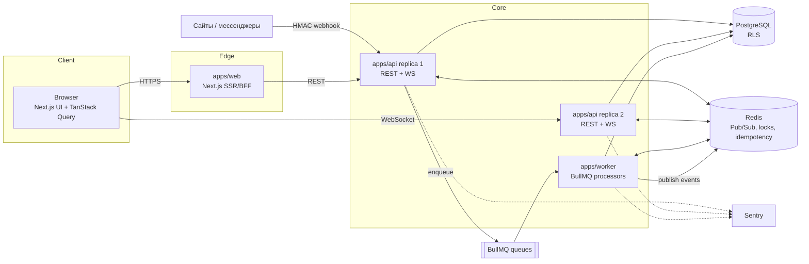
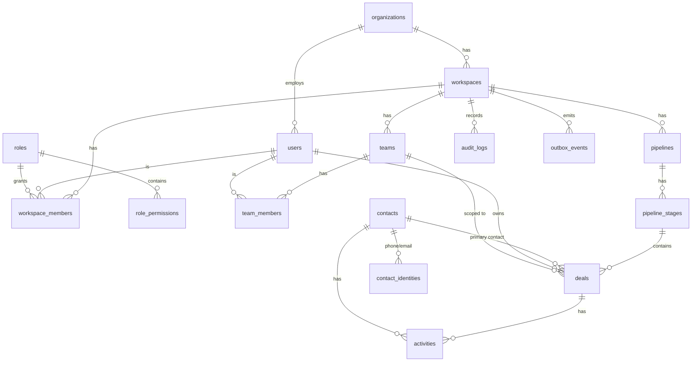
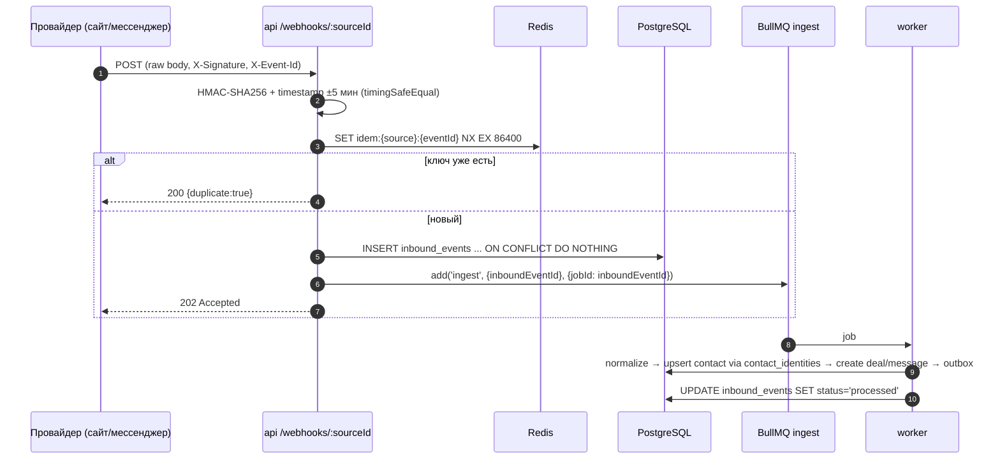
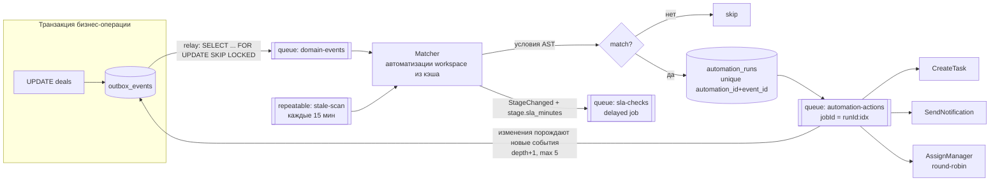

# Lead-to-Deal Engine — технический дизайн

> CRM для сервисного B2B: лиды → сделки, омниканальный инбокс, движок автоматизаций.
> Документ описывает архитектуру и нетривиальные места реализации. Код — эталонные фрагменты, не псевдокод.

**Содержание**

0. [Архитектура верхнего уровня](#0-архитектура-верхнего-уровня)
1. [Модель данных, RBAC и multi-tenancy](#1-модель-данных-rbac-и-multi-tenancy)
2. [Real-time канбан](#2-real-time-канбан)
3. [Webhook ingestion pipeline](#3-webhook-ingestion-pipeline)
4. [Workflow engine](#4-workflow-engine)
5. [План разработки и тестовая стратегия](#5-план-разработки-и-тестовая-стратегия)
6. [Ключевые инженерные решения](#6-ключевые-инженерные-решения)

---

## 0. Архитектура верхнего уровня

### Почему Next.js **и** Fastify, а не только API Routes

| Требование | Next.js Route Handlers | Fastify |
|---|---|---|
| Долгоживущие WebSocket-соединения | Нет (handler — request/response, на serverless вообще невозможно) | Да, `@fastify/websocket` / Socket.io на том же `http.Server` |
| Raw body для HMAC-подписи | Можно, но неудобно и легко сломать парсингом | `addContentTypeParser(..., { parseAs: 'buffer' })` |
| Жизненный цикл процесса (пулы БД, Redis-подписки, graceful shutdown) | Неявный, зависит от рантайма/деплоя | Явный: `onReady` / `onClose` хуки |
| Схемы запросов/ответов, сериализация | Ручная | JSON-schema / zod type provider, быстрый сериалайзер |
| Фоновые воркеры | Не предназначен | Отдельный процесс из того же монорепо |

**Решение:** Next.js — это UI и тонкий BFF (SSR первой отрисовки, cookie-сессия). Вся доменная логика, WS-шлюз и вебхуки живут в Fastify. BullMQ-воркеры — отдельный процесс, переиспользующий доменные пакеты. Next.js и Fastify можно масштабировать независимо, а вебхуки не делят event loop с SSR.

### Монорепо

```
apps/
  web/        # Next.js App Router, TanStack Query, shadcn/ui
  api/        # Fastify: REST, WebSocket gateway, webhooks
  worker/     # BullMQ processors: ingestion, automations, SLA, outbox relay
packages/
  db/         # Drizzle schema, миграции, withRls(), RLS SQL
  domain/     # чистая доменная логика: policies, ranking, conditions, round-robin
  contracts/  # zod-схемы DTO и событий, общие для web/api/worker
  config/     # tsconfig, eslint, env-валидация
```

pnpm workspaces + Turborepo. `packages/domain` не зависит ни от БД, ни от HTTP — его покрывают быстрые юнит-тесты.



**ORM: Drizzle.** Аргументы: SQL-первый подход (RLS-политики, частичные индексы, `FOR UPDATE SKIP LOCKED`, CTE пишутся естественно), нет отдельного query engine, предсказуемые запросы, транзакции как обычные функции — критично для `set_config` в начале каждой транзакции.

---

## 1. Модель данных, RBAC и multi-tenancy

### 1.1 Иерархия тенантов

- **Organization** — юрлицо-клиент, граница биллинга и изоляции данных (tenant).
- **Workspace** — бизнес-юнит внутри организации (например, «Москва» и «Казань»); у каждого свои воронки.
- **Team** — команда продаж внутри workspace, у команды есть лид.
- **Membership** — пользователь состоит в workspace с ролью и (опционально) в команде.

### 1.2 ER-диаграмма



### 1.3 Модель видимости

Права разделены на две оси — это ключ к тому, чтобы не плодить роли:

1. **Действия** (`deal:read`, `deal:update`, `deal:reassign`, `automation:manage`, …) — что можно делать.
2. **Scope видимости** (`all` | `team` | `own`) — над какими строками.

| Роль | Scope | Пример прав |
|---|---|---|
| SuperAdmin | `all` | всё, включая `settings:manage`, `automation:manage` |
| Sales Lead | `team` | `deal:*`, `deal:reassign` внутри своих команд |
| Sales Rep | `own` | `deal:read`, `deal:update`, `activity:create` |

Сделка хранит `owner_id` и `team_id` (команда, которой принадлежит сделка; проставляется при назначении). Лид видит сделки `team_id ∈ led_team_ids`, реп — `owner_id = me`.

### 1.4 Схема (Drizzle)

```ts
// packages/db/src/schema/core.ts
import {
  pgTable, uuid, text, timestamp, integer, numeric, boolean, jsonb,
  pgEnum, index, uniqueIndex, primaryKey,
} from 'drizzle-orm/pg-core';
import { sql } from 'drizzle-orm';

const id = () => uuid('id').primaryKey().default(sql`gen_random_uuid()`);
const tenantCols = () => ({
  organizationId: uuid('organization_id').notNull(),
  workspaceId: uuid('workspace_id').notNull(),
});
const timestamps = () => ({
  createdAt: timestamp('created_at', { withTimezone: true }).notNull().defaultNow(),
  updatedAt: timestamp('updated_at', { withTimezone: true }).notNull().defaultNow(),
});

export const visibilityScope = pgEnum('visibility_scope', ['all', 'team', 'own']);

export const organizations = pgTable('organizations', {
  id: id(),
  name: text('name').notNull(),
  slug: text('slug').notNull().unique(),
  ...timestamps(),
});

export const workspaces = pgTable('workspaces', {
  id: id(),
  organizationId: uuid('organization_id').notNull().references(() => organizations.id),
  name: text('name').notNull(),
  ...timestamps(),
});

export const users = pgTable('users', {
  id: id(),
  organizationId: uuid('organization_id').notNull().references(() => organizations.id),
  email: text('email').notNull(),
  fullName: text('full_name').notNull(),
  isActive: boolean('is_active').notNull().default(true),
  ...timestamps(),
}, (t) => [uniqueIndex('users_org_email_uq').on(t.organizationId, t.email)]);

export const roles = pgTable('roles', {
  id: id(),
  organizationId: uuid('organization_id').notNull(),
  key: text('key').notNull(),                       // 'super_admin' | 'sales_lead' | 'sales_rep' | custom
  scope: visibilityScope('scope').notNull(),
  isSystem: boolean('is_system').notNull().default(false),
}, (t) => [uniqueIndex('roles_org_key_uq').on(t.organizationId, t.key)]);

export const rolePermissions = pgTable('role_permissions', {
  roleId: uuid('role_id').notNull().references(() => roles.id, { onDelete: 'cascade' }),
  permission: text('permission').notNull(),         // 'deal:update', 'deal:reassign', ...
}, (t) => [primaryKey({ columns: [t.roleId, t.permission] })]);

export const workspaceMembers = pgTable('workspace_members', {
  workspaceId: uuid('workspace_id').notNull().references(() => workspaces.id),
  userId: uuid('user_id').notNull().references(() => users.id),
  roleId: uuid('role_id').notNull().references(() => roles.id),
}, (t) => [primaryKey({ columns: [t.workspaceId, t.userId] })]);

export const teams = pgTable('teams', {
  id: id(),
  ...tenantCols(),
  name: text('name').notNull(),
  parentTeamId: uuid('parent_team_id'),             // иерархия команд (опционально)
});

export const teamMembers = pgTable('team_members', {
  teamId: uuid('team_id').notNull().references(() => teams.id),
  userId: uuid('user_id').notNull().references(() => users.id),
  isLead: boolean('is_lead').notNull().default(false),
}, (t) => [primaryKey({ columns: [t.teamId, t.userId] })]);

export const pipelines = pgTable('pipelines', {
  id: id(),
  ...tenantCols(),
  name: text('name').notNull(),
  ...timestamps(),
});

export const pipelineStages = pgTable('pipeline_stages', {
  id: id(),
  ...tenantCols(),
  pipelineId: uuid('pipeline_id').notNull().references(() => pipelines.id),
  name: text('name').notNull(),
  rank: text('rank').notNull(),                     // fractional index, порядок колонок
  kind: text('kind').notNull().default('open'),     // 'open' | 'won' | 'lost'
  slaMinutes: integer('sla_minutes'),               // для SLA-эскалаций (раздел 4)
}, (t) => [index('stages_pipeline_rank_idx').on(t.pipelineId, t.rank)]);

export const contacts = pgTable('contacts', {
  id: id(),
  ...tenantCols(),
  fullName: text('full_name'),
  companyName: text('company_name'),
  ownerId: uuid('owner_id').references(() => users.id),
  mergedIntoId: uuid('merged_into_id'),             // soft-merge дублей
  ...timestamps(),
});

// Нормализованные идентификаторы — основа дедупликации (раздел 3)
export const contactIdentities = pgTable('contact_identities', {
  id: id(),
  ...tenantCols(),
  contactId: uuid('contact_id').notNull().references(() => contacts.id),
  kind: text('kind').notNull(),                     // 'phone' | 'email' | 'telegram' | 'whatsapp'
  value: text('value').notNull(),                   // E.164 / lower(email) / external id
}, (t) => [uniqueIndex('contact_identity_uq').on(t.workspaceId, t.kind, t.value)]);

export const deals = pgTable('deals', {
  id: id(),
  ...tenantCols(),
  pipelineId: uuid('pipeline_id').notNull().references(() => pipelines.id),
  stageId: uuid('stage_id').notNull().references(() => pipelineStages.id),
  rank: text('rank').notNull(),                     // fractional index внутри колонки
  title: text('title').notNull(),
  value: numeric('value', { precision: 14, scale: 2 }).notNull().default('0'),
  currency: text('currency').notNull().default('RUB'),
  contactId: uuid('contact_id').references(() => contacts.id),
  ownerId: uuid('owner_id').references(() => users.id),
  teamId: uuid('team_id').references(() => teams.id),
  stageEnteredAt: timestamp('stage_entered_at', { withTimezone: true }).notNull().defaultNow(),
  lastActivityAt: timestamp('last_activity_at', { withTimezone: true }),
  closedAt: timestamp('closed_at', { withTimezone: true }),   // выставляется при переходе в этап won/lost
  version: integer('version').notNull().default(1), // optimistic concurrency
  ...timestamps(),
}, (t) => [
  index('deals_board_idx').on(t.workspaceId, t.pipelineId, t.stageId, t.rank),
  index('deals_owner_idx').on(t.workspaceId, t.ownerId),
  index('deals_team_idx').on(t.workspaceId, t.teamId),
  index('deals_stale_idx').on(t.workspaceId, t.lastActivityAt).where(sql`closed_at is null`),
]);

export const activities = pgTable('activities', {
  id: id(),
  ...tenantCols(),
  dealId: uuid('deal_id').references(() => deals.id),
  contactId: uuid('contact_id').references(() => contacts.id),
  type: text('type').notNull(),                     // 'note' | 'call' | 'task' | 'message' | 'stage_change'
  payload: jsonb('payload').notNull().default({}),
  authorId: uuid('author_id'),                      // null => система/автоматизация
  dueAt: timestamp('due_at', { withTimezone: true }),
  completedAt: timestamp('completed_at', { withTimezone: true }),
  ...timestamps(),
}, (t) => [index('activities_deal_idx').on(t.dealId, t.createdAt)]);
```

**Омниканальный инбокс** — те же принципы, три таблицы: `channels` (подключённый Telegram-бот / WhatsApp / форма сайта, хранит зашифрованный секрет), `conversations (channel_id, contact_id, deal_id, assignee_id, last_message_at, unread_count)`, `messages (conversation_id, direction, external_id, body, attachments jsonb)` с `unique(channel_id, external_id)` для идемпотентности. Видимость conversations наследуется от сделки/контакта через ту же RLS-схему.

### 1.5 RLS: изоляция и видимость в одном месте

Принцип: **приложение не пишет `WHERE owner_id = …` в эндпоинтах вообще.** Middleware кладёт контекст в транзакционные GUC-переменные Postgres, а политики RLS превращают его в предикаты. Забытый фильтр физически невозможен: роль приложения не имеет `BYPASSRLS`, таблицы — `FORCE ROW LEVEL SECURITY`.

```sql
-- packages/db/migrations/0001_rls.sql (сокращённо)
create schema if not exists app;

-- Однострочные STABLE SQL-функции без подзапросов: планировщик их инлайнит
create function app.org_id() returns uuid language sql stable as
  $$ select nullif(current_setting('app.org_id', true), '')::uuid $$;
create function app.workspace_id() returns uuid language sql stable as
  $$ select nullif(current_setting('app.workspace_id', true), '')::uuid $$;
create function app.user_id() returns uuid language sql stable as
  $$ select nullif(current_setting('app.user_id', true), '')::uuid $$;
create function app.scope() returns text language sql stable as
  $$ select coalesce(nullif(current_setting('app.scope', true), ''), 'own') $$;
create function app.team_ids() returns uuid[] language sql stable as
  $$ select coalesce(nullif(current_setting('app.team_ids', true), ''), '{}')::uuid[] $$;

create function app.in_workspace(p_org uuid, p_ws uuid) returns boolean language sql stable as
  $$ select p_org = app.org_id() and p_ws = app.workspace_id() $$;
create function app.owner_visible(p_owner uuid, p_team uuid) returns boolean language sql stable as
  $$ select app.scope() = 'all'
         or (app.scope() = 'team' and p_team = any (app.team_ids()))
         or p_owner = app.user_id() $$;

-- Роль приложения: без BYPASSRLS; логин-роль crm_app_user входит в неё
create role crm_app nologin;
grant usage on schema public, app to crm_app;

alter table deals enable row level security;
alter table deals force row level security;

-- Один предикат на чтение и запись. WITH CHECK не даёт вывести строку из своей зоны:
-- реп не может переназначить сделку на коллегу, лид — увести её в чужую команду.
create policy deals_visibility on deals for all
  using      (app.in_workspace(organization_id, workspace_id) and app.owner_visible(owner_id, team_id))
  with check (app.in_workspace(organization_id, workspace_id) and app.owner_visible(owner_id, team_id));

-- Контакты: свои, scope=all, или привязанные к видимой сделке.
-- Подзапрос к deals сам проходит через RLS deals — рекурсии нет, т.к. deals не ссылается на contacts.
create policy contacts_visibility on contacts for all
  using (
    app.in_workspace(organization_id, workspace_id)
    and ((select app.scope()) = 'all'
         or owner_id = (select app.user_id())
         or exists (select 1 from deals d where d.contact_id = contacts.id))
  ) with check (/* то же выражение */);
```

**Почему функции без подзапросов.** Postgres инлайнит однострочную SQL-функцию, только если в её теле нет sub-SELECT. После инлайнинга предикат становится `workspace_id = nullif(current_setting(...))::uuid`. Это стабильное выражение, пригодное для Index Cond. Если обернуть вызовы в `(select ...)` внутри функции, инлайнинг отключится, и функция будет вызываться на каждую строку. Интеграционный тест проверяет это по `EXPLAIN`. Вторая ловушка: `team_id = any((select app.team_ids()))` парсится как `ANY (subquery)`, а не `ANY (array)`, и падает с `uuid = uuid[]`.

**Связи между тенантами.** Проверки FK выполняются в обход RLS, поэтому одиночный `contact_id` позволил бы сослаться на контакт чужой организации. Все внутритенантные ссылки сделаны составными FK вида `(workspace_id, contact_id) → contacts(workspace_id, id)`.

**Почему GUC, а не отдельная DB-роль на пользователя:** роли на пользователя не масштабируются и ломают пул соединений. `set_config(..., true)` — transaction-local, поэтому безопасен и с пулом в приложении, и с PgBouncer в transaction mode.

### 1.6 Middleware: контекст → транзакция

```ts
// packages/db/src/with-rls.ts
import { sql } from 'drizzle-orm';
import { db, type Tx } from './client';

export interface AuthContext {
  organizationId: string;
  workspaceId: string;
  userId: string;
  scope: 'all' | 'team' | 'own';
  teamIds: string[];          // команды, где пользователь лид (+ подкоманды)
  permissions: ReadonlySet<string>;
}

export function withRls<T>(ctx: AuthContext, fn: (tx: Tx) => Promise<T>): Promise<T> {
  return db.transaction(async (tx) => {
    await tx.execute(sql`
      select
        set_config('app.org_id',       ${ctx.organizationId}, true),
        set_config('app.workspace_id', ${ctx.workspaceId}, true),
        set_config('app.user_id',      ${ctx.userId}, true),
        set_config('app.scope',        ${ctx.scope}, true),
        set_config('app.team_ids',     ${`{${ctx.teamIds.join(',')}}`}, true)
    `);
    return fn(tx);
  });
}
```

Контекст собирается один раз на запрос и кэшируется в Redis на 60 с (ключ `authctx:{userId}:{workspaceId}`, инвалидация при смене роли/команды). `teamIds` для иерархии команд — рекурсивный CTE по `teams.parent_team_id`, результат тоже в кэше.

```ts
// apps/api/src/plugins/auth-context.ts
import fp from 'fastify-plugin';
import { withRls, type AuthContext, type Tx } from '@crm/db';

declare module 'fastify' {
  interface FastifyRequest {
    auth: AuthContext;
    tx<T>(fn: (tx: Tx) => Promise<T>): Promise<T>;
  }
}

export default fp(async (app) => {
  app.decorateRequest('auth', null as unknown as AuthContext);
  app.decorateRequest('tx', null as unknown as FastifyRequest['tx']);

  app.addHook('preHandler', async (req) => {
    if (req.routeOptions.config.public) return;
    const session = await app.sessions.verify(req);                    // cookie/JWT
    const workspaceId = req.headers['x-workspace-id'] as string;
    req.auth = await app.authContext.load(session.userId, workspaceId); // Redis-кэш
    req.tx = (fn) => withRls(req.auth, fn);
  });
});

// Проверка действия — декларативно на роуте
export const requirePermission = (perm: string) => async (req: FastifyRequest) => {
  if (!req.auth.permissions.has(perm)) throw app.httpErrors.forbidden(perm);
};
```

Эндпоинт после этого выглядит так — ни одного условия про роли:

```ts
app.get('/pipelines/:pipelineId/board', {
  preHandler: requirePermission('deal:read'),
  schema: { params: PipelineParams, response: { 200: BoardResponse } },
}, (req) =>
  req.tx((tx) =>
    tx.select().from(deals)
      .where(eq(deals.pipelineId, req.params.pipelineId))
      .orderBy(deals.stageId, deals.rank, deals.id),
  ),
);
```

**Слоистая защита:** RLS отвечает за *какие строки*, `requirePermission` — за *какие действия*, доменные политики в `packages/domain` — за бизнес-инварианты (например, «закрыть сделку в won может только владелец или лид»). Те же предикаты видимости продублированы в `packages/domain/visibility.ts` как чистая функция — она нужна WS-шлюзу (раздел 2.4) и покрыта тестом на эквивалентность с RLS.

### 1.7 Audit log через триггер

Аудит через триггер ловит изменения из любых путей (API, воркер, миграция данных), а автора берёт из того же GUC.

```sql
create table audit_logs (
  id            bigint generated always as identity,
  organization_id uuid not null,
  workspace_id  uuid not null,
  actor_id      uuid,                       -- null => система
  entity        text not null,
  entity_id     uuid not null,
  action        text not null,              -- insert | update | delete
  diff          jsonb not null,
  created_at    timestamptz not null default now(),
  primary key (id, created_at)
) partition by range (created_at);          -- помесячные партиции (pg_partman или cron-джоба)

create function app.audit() returns trigger language plpgsql security definer as $$
declare
  changes jsonb;
begin
  if tg_op = 'UPDATE' then
    select jsonb_object_agg(n.key, jsonb_build_array(o.value, n.value)) into changes
    from jsonb_each(to_jsonb(new)) n
    join jsonb_each(to_jsonb(old)) o using (key)
    where n.value is distinct from o.value and n.key not in ('updated_at', 'version');
    if changes is null then return new; end if;
  else
    changes := to_jsonb(coalesce(new, old));
  end if;

  insert into audit_logs (organization_id, workspace_id, actor_id, entity, entity_id, action, diff)
  values (coalesce(new, old).organization_id, coalesce(new, old).workspace_id,
          app.user_id(), tg_table_name, coalesce(new, old).id, lower(tg_op), changes);
  return coalesce(new, old);
end $$;

create trigger deals_audit after insert or update or delete on deals
  for each row execute function app.audit();
```

`audit_logs` для `crm_app` — только `INSERT` через триггер (`security definer`) и `SELECT` с RLS `scope = 'all'`; `UPDATE/DELETE` не выданы никому, кроме роли миграций.

---

## 2. Real-time канбан

### 2.1 Порядок карточек: fractional indexing

Вместо целочисленного `order_index` — строковый ключ `rank` (библиотека `fractional-indexing`, алфавит base62). Перемещение карточки между `A` и `B` = **один UPDATE одной строки**: новый ключ строго между соседями.

```
"a0" < "a0V" < "a1"     ← вставка между a0 и a1
```

- Колонка `rank text collate "C"` — побайтовое сравнение, одинаковое в Postgres и JS.
- Сортировка `ORDER BY rank, id` — `id` как tie-breaker, если два клиента одновременно вставили карточку в одно место и получили одинаковый ключ.
- Ключи растут при многократной вставке в одну точку. Фоновая джоба `rebalance-stage` перенумеровывает колонку, когда `max(length(rank)) > 32` (ровные ключи `generateNKeysBetween(null, null, n)` одним `UPDATE … FROM (VALUES …)`), и шлёт `stage.rebalanced` — клиенты просто рефетчат колонку.

```ts
// packages/domain/src/ranking.ts
import { generateKeyBetween } from 'fractional-indexing';

export const RANK_REBALANCE_THRESHOLD = 32;

export function rankBetween(before: string | null, after: string | null): string {
  if (before !== null && after !== null && before >= after) {
    // клиент прислал устаревших соседей: (before, after) могли поменяться местами
    throw new RankConflictError(before, after);
  }
  return generateKeyBetween(before, after);
}

export const needsRebalance = (rank: string) => rank.length > RANK_REBALANCE_THRESHOLD;
```

### 2.2 Протокол перемещения

Клиент присылает **id соседей**, а не готовый ключ. Сервер сам читает их ранги в транзакции — так клиент с устаревшим состоянием не испортит порядок.

```ts
// contracts
export const MoveDealInput = z.object({
  toStageId: z.string().uuid(),
  beforeId: z.string().uuid().nullable(),   // карточка над местом вставки
  afterId: z.string().uuid().nullable(),    // карточка под местом вставки
  clientMutationId: z.string(),             // чтобы отфильтровать собственное эхо из WS
});
```

```ts
// apps/api/src/modules/deals/move-deal.ts
export async function moveDeal(req: FastifyRequest<{ Params: { id: string }; Body: MoveDealInput }>) {
  const { id } = req.params;
  const { toStageId, beforeId, afterId, clientMutationId } = req.body;

  const result = await req.tx(async (tx) => {
    const neighbours = await tx
      .select({ id: deals.id, rank: deals.rank, stageId: deals.stageId })
      .from(deals)
      .where(inArray(deals.id, [beforeId, afterId].filter(Boolean) as string[]));

    const before = neighbours.find((n) => n.id === beforeId);
    const after = neighbours.find((n) => n.id === afterId);
    if ([before, after].some((n) => n && n.stageId !== toStageId)) throw new RankConflictError();

    const rank = rankBetween(before?.rank ?? null, after?.rank ?? null);

    const [prev] = await tx.select({ stageId: deals.stageId }).from(deals)
      .where(eq(deals.id, id)).for('update');
    if (!prev) throw req.server.httpErrors.notFound();      // не видна под RLS == не существует

    const stageChanged = prev.stageId !== toStageId;
    const [updated] = await tx.update(deals).set({
      stageId: toStageId,
      rank,
      version: sql`${deals.version} + 1`,
      updatedAt: sql`now()`,
      ...(stageChanged && { stageEnteredAt: sql`now()` }),
    }).where(eq(deals.id, id)).returning();

    if (stageChanged) {
      // событие для движка автоматизаций — в той же транзакции (transactional outbox, раздел 4)
      await appendOutbox(tx, req.auth, {
        type: 'deal.stage_changed',
        dealId: id, fromStageId: prev.stageId, toStageId, stageEnteredAt: updated.stageEnteredAt,
      });
    }
    return updated;
  });

  // После коммита: real-time — best effort, клиенты добирают пропущенное рефетчем при reconnect
  await req.server.realtime.publishDeal(result, { type: 'deal.moved', clientMutationId, actorId: req.auth.userId });
  if (needsRebalance(result.rank)) await req.server.queues.maintenance.add('rebalance-stage',
    { stageId: result.stageId }, { jobId: `rebalance:${result.stageId}`, delay: 5_000 });

  return result;
}
```

`RankConflictError` → HTTP 409; клиент откатывает оптимистичное изменение и рефетчит колонку.

**Одинаковые ранги.** Если два клиента одновременно вставят карточку в одну и ту же щель, обе получат один и тот же ключ. Порядок между ними держит tie-breaker по `id`. Вставить строго между двумя равными ключами невозможно, поэтому сервер ставит карточку сразу после группы одинаковых: `rankBetween(before.rank, min(rank > before.rank))`. Глобальная блокировка колонки здесь не нужна. Реализация — `apps/api/src/modules/deals/service.ts`, `rankForGap`.

### 2.3 Оптимистичный апдейт на клиенте

```ts
// apps/web/src/features/board/use-move-deal.ts
export function useMoveDeal(pipelineId: string) {
  const qc = useQueryClient();
  const key = boardKeys.board(pipelineId);

  return useMutation({
    mutationFn: (v: MoveDealVars) => api.deals.move(v.dealId, v.input),

    onMutate: async ({ dealId, input }) => {
      await qc.cancelQueries({ queryKey: key });         // не дать in-flight рефетчу затереть оптимистику
      const snapshot = qc.getQueryData<Board>(key);

      qc.setQueryData<Board>(key, (board) => board && applyMove(board, dealId, input));
      pendingMutations.add(input.clientMutationId);
      return { snapshot };
    },

    onError: (_err, _vars, ctx) => {
      if (ctx?.snapshot) qc.setQueryData(key, ctx.snapshot);
      toast.error('Карточку переместил кто-то другой — доска обновлена');
    },

    onSettled: (_d, _e, { input }) => {
      pendingMutations.delete(input.clientMutationId);
    },
  });
}
```

`applyMove` — чистая функция из `packages/domain` (локально вычисляет тот же `rankBetween`, чтобы порядок на клиенте совпал с серверным). WS-событие с собственным `clientMutationId` игнорируется; чужие события применяются через `setQueryData` без рефетча, если `event.version > local.version`, иначе отбрасываются.

### 2.4 Синхронизация между репликами

Socket.io + `@socket.io/redis-adapter` (Redis Pub/Sub под капотом). Видимость решается **комнатами**, повторяющими модель RBAC:

| Комната | Кто подписан |
|---|---|
| `ws:{workspaceId}:all` | пользователи со scope `all` |
| `team:{teamId}` | лиды этой команды |
| `user:{userId}` | конкретный пользователь (его сделки, уведомления) |
| `deal:{dealId}` | открывшие карточку сделки (presence, комментарии) |

Событие сделки отправляется в объединение трёх комнат — Socket.io дедуплицирует сокет, входящий в несколько из них. Реп, которому сделка не видна, событие не получит.

```ts
// apps/api/src/realtime/publisher.ts
export function createRealtime(io: Server) {
  return {
    async publishDeal(deal: DealRow, meta: { type: string; clientMutationId?: string; actorId: string; previous?: Pick<DealRow, 'ownerId' | 'teamId'> }) {
      const rooms = dealRooms(deal);
      io.to(rooms).emit('deal.event', { ...meta, deal: toDealDto(deal) });

      // Сделку переназначили — у прежних получателей она должна исчезнуть
      if (meta.previous) {
        const lost = dealRooms({ ...deal, ...meta.previous }).filter((r) => !rooms.includes(r));
        if (lost.length) io.to(lost).except(rooms).emit('deal.removed', { dealId: deal.id });
      }
    },
  };
}

const dealRooms = (d: Pick<DealRow, 'workspaceId' | 'teamId' | 'ownerId'>) =>
  [`ws:${d.workspaceId}:all`, d.teamId && `team:${d.teamId}`, d.ownerId && `user:${d.ownerId}`]
    .filter(Boolean) as string[];
```

Воркеры (автоматизации меняют сделки) публикуют через `@socket.io/redis-emitter` — без поднятия собственного Socket.io-сервера.

```mermaid
sequenceDiagram
  autonumber
  participant U1 as Менеджер A (браузер)
  participant API1 as api replica 1
  participant PG as PostgreSQL
  participant R as Redis Pub/Sub
  participant API2 as api replica 2
  participant U2 as Лид B (браузер)

  U1->>U1: drag → setQueryData (оптимистично)
  U1->>API1: PATCH /deals/:id/move {beforeId, afterId}
  API1->>PG: BEGIN; set_config(...); SELECT ranks; UPDATE deals; INSERT outbox; COMMIT
  API1-->>U1: 200 {deal, version}
  API1->>R: emit to [ws:all, team:T, user:A]
  R->>API2: fan-out
  API2->>U2: deal.event (version N+1)
  U2->>U2: setQueryData если version > local
```

**Reconnect:** при восстановлении сокета клиент вызывает `qc.invalidateQueries(boardKeys.all)`. Это проще и надёжнее, чем replay-лог, и при Pub/Sub без гарантий доставки — единственно корректный вариант.

### 2.5 Presence и мягкие блокировки

Два разных механизма:

- **Presence** («кто смотрит карточку») — множество, многие читатели.
- **Soft lock** («кто редактирует») — один владелец, с TTL и heartbeat. Мягкий: не запрещает сохранение другим, а показывает предупреждение; защиту от потери данных даёт `version` (optimistic concurrency → 409).

```ts
// apps/api/src/realtime/locks.ts
const LOCK_TTL_MS = 30_000;

// Захват или продление своим же владельцем — атомарно
const ACQUIRE = `
local cur = redis.call('GET', KEYS[1])
if not cur then
  redis.call('SET', KEYS[1], ARGV[1], 'PX', ARGV[2]); return {1, ARGV[1]}
end
local owner = cjson.decode(cur)
local me = cjson.decode(ARGV[1])
if owner.userId == me.userId then
  redis.call('SET', KEYS[1], ARGV[1], 'PX', ARGV[2]); return {1, ARGV[1]}
end
return {0, cur}`;

// Отпустить только свою блокировку
const RELEASE = `
local cur = redis.call('GET', KEYS[1])
if cur and cjson.decode(cur).socketId == ARGV[1] then return redis.call('DEL', KEYS[1]) end
return 0`;

export function registerLockHandlers(io: Server, socket: AuthedSocket, redis: Redis) {
  const holder = () => JSON.stringify({
    userId: socket.data.auth.userId, name: socket.data.user.fullName, socketId: socket.id,
  });

  socket.on('deal.edit.start', async ({ dealId }, ack) => {
    if (!(await canSeeDeal(socket.data.auth, dealId))) return ack({ ok: false });
    const [acquired, raw] = await redis.eval(ACQUIRE, 1, `lock:deal:${dealId}`, holder(), LOCK_TTL_MS) as [number, string];
    const lock = JSON.parse(raw);
    if (acquired) io.to(`deal:${dealId}`).emit('deal.lock', { dealId, lockedBy: lock });
    ack({ ok: true, acquired: Boolean(acquired), lockedBy: lock });
  });

  socket.on('deal.edit.heartbeat', ({ dealId }) =>   // раз в 10 с, пока форма открыта
    redis.eval(ACQUIRE, 1, `lock:deal:${dealId}`, holder(), LOCK_TTL_MS));

  socket.on('deal.edit.stop', ({ dealId }) => release(dealId));
  socket.on('disconnect', async () => {
    for (const dealId of socket.data.editing) await release(dealId);
  });

  async function release(dealId: string) {
    if (await redis.eval(RELEASE, 1, `lock:deal:${dealId}`, socket.id)) {
      io.to(`deal:${dealId}`).emit('deal.lock', { dealId, lockedBy: null });
    }
  }
}
```

- Падение реплики без `disconnect` → блокировка истекает по TTL сама. Чтобы клиенты узнали об этом, holder при открытии карточки получает `expiresAt` и перезапрашивает статус после истечения.
- Presence: `HSET presence:deal:{id} {socketId} {userJson}` + `PEXPIRE` 60 с, обновляется тем же heartbeat. На доске индикатор «Редактирует Иван» показывается по событию `deal.lock`, разосланному также в комнаты доски (`dealRooms`).

---

## 3. Webhook ingestion pipeline



> **Как реализовано (неделя 3).** Источник вебхуков — таблица `channels`, а не отдельная `webhook_sources`. В ней же лежат зашифрованные секреты: HMAC-ключ, secret token Telegram и токен бота (AES-256-GCM, ключ в `SECRETS_KEY` вне БД). Роль приложения секретные колонки не читает; публичный эндпоинт получает их через `app.webhook_channel()`.
>
> Отличия от наброска ниже:
> - jobId имеют вид `ingest-<id>`: BullMQ 6 запрещает `:` в пользовательских id.
> - Контакт виден и тому, кто видит его диалог, — иначе ответственный за диалог без сделки не видит собеседника.
> - Нагрузочную проверку делает e2e-тест `apps/worker/test/pipeline.e2e.test.ts`: 600 запросов, из них 100 дублей, через реальный HTTP и BullMQ, с проверкой инвариантов. k6-скрипт ниже — для прогона против стенда.

### 3.1 Хранилище входящих событий

```sql
create table inbound_events (
  id            uuid primary key default gen_random_uuid(),
  organization_id uuid not null,
  workspace_id  uuid not null,
  source_id     uuid not null references webhook_sources(id),
  external_id   text not null,               -- id события у провайдера или sha256(body)
  payload       jsonb not null,
  status        text not null default 'received',  -- received | processed | failed
  attempts      int  not null default 0,
  error         text,
  received_at   timestamptz not null default now(),
  processed_at  timestamptz,
  unique (source_id, external_id)
);
create index inbound_events_pending_idx on inbound_events (received_at) where status = 'received';
```

Redis — быстрый фильтр дублей, **источник истины — unique-констрейнт в БД.** Сырой payload сохраняется до любой бизнес-логики: если нормализатор упал из-за смены формата у провайдера, событие можно переиграть после фикса.

### 3.2 Эндпоинт

```ts
// apps/api/src/modules/webhooks/route.ts
import { createHmac, timingSafeEqual, createHash } from 'node:crypto';

const TOLERANCE_SEC = 300;

export default async function webhooksRoutes(app: FastifyInstance) {
  // raw body только в этом scope — подпись считается от байтов, а не от JSON.parse→stringify
  app.addContentTypeParser('application/json', { parseAs: 'buffer' }, (_req, body, done) => done(null, body));

  app.post<{ Params: { sourceId: string } }>('/webhooks/:sourceId', {
    config: { public: true, rateLimit: { max: 600, timeWindow: '1 minute', keyGenerator: (r) => r.params.sourceId } },
    bodyLimit: 256 * 1024,
  }, async (req, reply) => {
    const raw = req.body as Buffer;
    const source = await app.webhookSources.get(req.params.sourceId);   // кэш, секреты расшифрованы
    if (!source?.enabled) return reply.code(404).send();

    if (!verifySignature(raw, req.headers['x-signature'] as string | undefined, source.secrets)) {
      req.log.warn({ sourceId: source.id }, 'webhook signature mismatch');
      return reply.code(401).send();
    }

    const externalId = (req.headers['x-event-id'] as string | undefined)
      ?? createHash('sha256').update(raw).digest('hex');
    const idemKey = `idem:${source.id}:${externalId}`;

    const fresh = await app.redis.set(idemKey, '1', 'EX', 86_400, 'NX');
    if (!fresh) return reply.code(200).send({ duplicate: true });

    try {
      const [event] = await app.db.insert(inboundEvents).values({
        organizationId: source.organizationId,
        workspaceId: source.workspaceId,
        sourceId: source.id,
        externalId,
        payload: JSON.parse(raw.toString('utf8')),
      }).onConflictDoNothing().returning({ id: inboundEvents.id });

      if (!event) return reply.code(200).send({ duplicate: true });       // Redis-ключ истёк, БД помнит

      await app.queues.ingest.add('ingest', { inboundEventId: event.id }, {
        jobId: event.id,                                                // BullMQ не создаст дубль
        attempts: 8, backoff: { type: 'exponential', delay: 2_000 },
        removeOnComplete: { age: 3_600 }, removeOnFail: { age: 7 * 86_400 },
      });
      return reply.code(202).send({ id: event.id });
    } catch (err) {
      await app.redis.del(idemKey);   // дать провайдеру успешно ретраить
      throw err;
    }
  });
}

/** Формат заголовка: `t=1730000000,v1=<hex>[,v1=<hex>]`. Подпись = HMAC(secret, `${t}.${rawBody}`).
 *  Несколько секретов — бесшовная ротация. */
export function verifySignature(raw: Buffer, header: string | undefined, secrets: string[], now = Date.now()) {
  if (!header) return false;
  const parts = header.split(',').map((p) => p.split('=') as [string, string]);
  const t = Number(parts.find(([k]) => k === 't')?.[1]);
  const sigs = parts.filter(([k]) => k === 'v1').map(([, v]) => Buffer.from(v, 'hex'));
  if (!Number.isFinite(t) || Math.abs(now / 1000 - t) > TOLERANCE_SEC) return false;   // replay-защита

  return secrets.some((secret) => {
    const expected = createHmac('sha256', secret).update(`${t}.`).update(raw).digest();
    return sigs.some((s) => s.length === expected.length && timingSafeEqual(s, expected));
  });
}
```

**Страховка от потери между INSERT и enqueue** (процесс упал после коммита): cron-джоба раз в минуту берёт `status = 'received' and received_at < now() - interval '1 minute'` и переставляет в очередь — `jobId` делает это идемпотентным.

### 3.3 Воркер: нормализация и дедупликация контактов

Провайдер-специфичные адаптеры приводят payload к одному виду:

```ts
// packages/contracts/src/lead.ts
export const NormalizedLead = z.object({
  channel: z.enum(['website_form', 'telegram', 'whatsapp', 'email']),
  name: z.string().trim().max(200).optional(),
  phone: z.string().optional(),           // уже E.164 (libphonenumber-js, регион по умолчанию из workspace)
  email: z.string().email().toLowerCase().optional(),
  externalUserId: z.string().optional(),  // telegram user id и т.п.
  message: z.string().max(10_000).optional(),
  utm: z.record(z.string()).optional(),
});
```

**Гонка:** два лида с одним телефоном обрабатываются параллельно → оба не находят контакт → два контакта. Решение — уникальный индекс `contact_identities(workspace_id, kind, value)` и паттерн «вставь-или-прочитай» под advisory lock на набор идентификаторов:

```ts
// apps/worker/src/ingest/resolve-contact.ts
export async function resolveContact(tx: Tx, ws: TenantRef, lead: NormalizedLead) {
  const ids = identitiesOf(lead);           // [{kind:'phone', value:'+7999…'}, {kind:'email', value:'…'}]
  if (ids.length === 0) return createContact(tx, ws, lead, []);

  // Сериализуем только конкурирующих за те же идентификаторы. Сортировка — против дедлоков.
  for (const key of ids.map((i) => `${ws.workspaceId}:${i.kind}:${i.value}`).sort()) {
    await tx.execute(sql`select pg_advisory_xact_lock(hashtextextended(${key}, 0))`);
  }

  const matches = await tx.select({ contactId: contactIdentities.contactId })
    .from(contactIdentities)
    .where(and(
      eq(contactIdentities.workspaceId, ws.workspaceId),
      or(...ids.map((i) => and(eq(contactIdentities.kind, i.kind), eq(contactIdentities.value, i.value)))),
    ));

  const contactIds = [...new Set(matches.map((m) => m.contactId))];

  if (contactIds.length === 0) return createContact(tx, ws, lead, ids);

  const primary = contactIds[0];
  if (contactIds.length > 1) {
    // телефон указывает на один контакт, email — на другой: не мёржим молча, создаём задачу на ревью
    await tx.insert(mergeCandidates).values({ ...ws, contactIds, reason: 'identity_conflict' }).onConflictDoNothing();
  }
  // Дописать недостающие идентификаторы к найденному контакту
  await tx.insert(contactIdentities)
    .values(ids.map((i) => ({ ...ws, contactId: primary, ...i })))
    .onConflictDoNothing();
  return { contactId: primary, created: false };
}
```

Процессор целиком: `withSystemRls(workspace)` (тот же `withRls` со `scope = 'all'` и `user_id = null`) → `resolveContact` → найти открытую сделку контакта в воронке по умолчанию или создать новую в первом этапе → `activities`/`messages` → `outbox: lead.created` → `inbound_events.status = 'processed'`. Всё в одной транзакции, поэтому повтор джобы после сбоя безопасен.

---

## 4. Workflow engine

> **Как реализовано (неделя 4).** Отличия от наброска ниже.
> - **Relay** забирает пачку функцией `app.claim_outbox()`: это `UPDATE … RETURNING` с `FOR UPDATE SKIP LOCKED`, вызываемый внутри той же транзакции, что и `addBulk`. Сбой постановки в очередь откатывает захват. Опрос раз в 250 мс; LISTEN/NOTIFY остался возможной оптимизацией задержки.
> - **Запуск выполняется одной задачей `execute-run`**, а не задачей на действие. Действия идут строго по порядку: сначала AssignManager, потом «уведомить ответственного». Каждое действие — своя транзакция вместе с `completed_actions + 1`, так что ретрай продолжает с невыполненного шага, и эффекты в БД применяются ровно один раз.
> - **AssignManager разбит на две транзакции.** Короткая резервирует менеджера: блокирует пул и записывает выбор в `automation_runs.state`. Вторая применяет назначение. В первой версии назначение держало блокировку сделки, пока ждало горячую строку пула, и под нагрузкой это блокировало ingest повторных лидов: разбор очереди в burst-тесте занимал 16,4 с против 2,3 с без автоматизаций. После разделения — 3,5–5,7 с. На ретрае используется уже зарезервированный менеджер, и ротация не сдвигается дважды.
> - **Назначение уводит к менеджеру и диалоги сделки** — иначе он видел бы сделку, но не переписку.
> - **Условие на сумму** сравнивается как число: `numeric` приходит строкой.
> - **Шаблоны уведомлений** поддерживают `{{deal.title}}` и `{{deal.value}}`.

### 4.1 Поток событий



**Почему transactional outbox, а не `queue.add()` прямо в обработчике:** если `add` выполнен до коммита, а транзакция откатилась — автоматизация сработает на несуществующее изменение; если после коммита и процесс упал — событие потеряно. Outbox пишется атомарно с изменением, relay доставляет at-least-once, идемпотентность обеспечивают `automation_runs` и `jobId`.

```sql
create table outbox_events (
  id            bigint generated always as identity primary key,
  organization_id uuid not null,
  workspace_id  uuid not null,
  type          text not null,          -- deal.stage_changed | lead.created | deal.updated ...
  payload       jsonb not null,
  actor         jsonb not null,         -- {kind:'user', id} | {kind:'automation', id, depth}
  created_at    timestamptz not null default now(),
  published_at  timestamptz
);
create index outbox_unpublished_idx on outbox_events (id) where published_at is null;
```

```ts
// apps/worker/src/outbox/relay.ts — несколько экземпляров безопасны благодаря SKIP LOCKED
export async function relayBatch(db: Db, queue: Queue, limit = 200) {
  return db.transaction(async (tx) => {
    const rows = await tx.execute<OutboxRow>(sql`
      select * from outbox_events
      where published_at is null
      order by id
      limit ${limit}
      for update skip locked`);
    if (rows.length === 0) return 0;

    await queue.addBulk(rows.map((r) => ({
      name: r.type,
      data: r,
      opts: { jobId: `evt:${r.id}`, attempts: 5, backoff: { type: 'exponential', delay: 1_000 } },
    })));
    await tx.execute(sql`update outbox_events set published_at = now()
                         where id = any(${rows.map((r) => r.id)})`);
    return rows.length;
  });
}
```

Relay крутится в цикле с `LISTEN outbox` (триггер `pg_notify` на INSERT) и fallback-поллингом раз в секунду. Старые опубликованные строки чистит cron.

### 4.2 Модель автоматизаций

```sql
create table automations (
  id            uuid primary key default gen_random_uuid(),
  organization_id uuid not null,
  workspace_id  uuid not null,
  name          text not null,
  trigger       jsonb not null,   -- {"type":"StageChanged","toStageId":"..."} | {"type":"NoActivityInDays","days":3}
  conditions    jsonb not null,   -- AST, см. ниже
  actions       jsonb not null,   -- массив действий
  enabled       boolean not null default true,
  version       int not null default 1,
  updated_at    timestamptz not null default now()
);

create table automation_runs (
  id            uuid primary key default gen_random_uuid(),
  automation_id uuid not null references automations(id),
  automation_version int not null,
  event_key     text not null,    -- 'evt:123' или 'stale:<dealId>:2026-10-26'
  deal_id       uuid,
  status        text not null default 'pending',  -- pending | succeeded | failed | skipped
  error         text,
  created_at    timestamptz not null default now(),
  unique (automation_id, event_key)
);
```

Условия — типизированный AST, а не строка с `eval`. Валидируется zod при сохранении и при чтении:

```ts
// packages/domain/src/automations/schema.ts
const FieldPath = z.enum(['deal.value', 'deal.pipelineId', 'deal.stageId', 'deal.ownerId', 'contact.source', 'deal.currency']);
const Op = z.enum(['eq', 'neq', 'gt', 'gte', 'lt', 'lte', 'in', 'isEmpty']);

export type Condition =
  | { all: Condition[] }
  | { any: Condition[] }
  | { not: Condition }
  | { field: z.infer<typeof FieldPath>; op: z.infer<typeof Op>; value?: unknown };

export const Condition: z.ZodType<Condition> = z.lazy(() => z.union([
  z.object({ all: z.array(Condition).max(20) }),
  z.object({ any: z.array(Condition).max(20) }),
  z.object({ not: Condition }),
  z.object({ field: FieldPath, op: Op, value: z.unknown().optional() }),
]));

export const Trigger = z.discriminatedUnion('type', [
  z.object({ type: z.literal('LeadCreated'), channel: z.string().optional() }),
  z.object({ type: z.literal('StageChanged'), toStageId: z.string().uuid().optional(), fromStageId: z.string().uuid().optional() }),
  z.object({ type: z.literal('NoActivityInDays'), days: z.number().int().min(1).max(90) }),
  z.object({ type: z.literal('StageSlaBreached') }),
]);

export const Action = z.discriminatedUnion('type', [
  z.object({ type: z.literal('CreateTask'), title: z.string(), dueInMinutes: z.number().int(), assignTo: z.enum(['owner', 'teamLead']) }),
  z.object({ type: z.literal('SendNotification'), to: z.enum(['owner', 'teamLead', 'admins']), template: z.string() }),
  z.object({ type: z.literal('AssignManager'), poolId: z.string().uuid() }),
]);
```

```ts
// packages/domain/src/automations/evaluate.ts
export function evaluate(c: Condition, facts: Facts): boolean {
  if ('all' in c) return c.all.every((x) => evaluate(x, facts));
  if ('any' in c) return c.any.some((x) => evaluate(x, facts));
  if ('not' in c) return !evaluate(c.not, facts);

  const actual = facts[c.field];
  switch (c.op) {
    case 'eq': return actual === c.value;
    case 'neq': return actual !== c.value;
    case 'gt': return toNum(actual) > toNum(c.value);
    case 'gte': return toNum(actual) >= toNum(c.value);
    case 'lt': return toNum(actual) < toNum(c.value);
    case 'lte': return toNum(actual) <= toNum(c.value);
    case 'in': return Array.isArray(c.value) && c.value.includes(actual);
    case 'isEmpty': return actual == null || actual === '';
  }
}
// deal.value — numeric(14,2): приходит строкой; сравниваем как число. Для денег > 2^53 понадобится decimal.js.
const toNum = (v: unknown) => (typeof v === 'number' ? v : Number(v));
```

Пример «сделка > 100 000 в воронке X»:

```json
{ "all": [
  { "field": "deal.value", "op": "gt", "value": 100000 },
  { "field": "deal.pipelineId", "op": "eq", "value": "6f1c…" }
]}
```

### 4.3 Matcher

```ts
// apps/worker/src/automations/matcher.ts
export const domainEventsProcessor = (deps: Deps) => async (job: Job<OutboxRow>) => {
  const evt = job.data;
  const depth = evt.actor.kind === 'automation' ? evt.actor.depth : 0;
  if (depth >= MAX_CHAIN_DEPTH) {                  // защита от циклов A→B→A
    deps.log.warn({ evt }, 'automation chain depth exceeded');
    return;
  }

  const automations = await deps.automationCache.forWorkspace(evt.workspace_id);  // in-memory, инвалидация через Redis pub
  const candidates = automations.filter((a) => triggerMatches(a.trigger, evt));
  if (candidates.length === 0) return;

  const facts = await deps.loadFacts(evt);         // актуальное состояние сделки/контакта на момент обработки

  for (const a of candidates) {
    if (!evaluate(a.conditions, facts)) continue;

    const [run] = await deps.db.insert(automationRuns).values({
      automationId: a.id, automationVersion: a.version, eventKey: `evt:${evt.id}`, dealId: facts['deal.id'],
    }).onConflictDoNothing().returning();
    if (!run) continue;                            // уже обработано (повтор доставки)

    await deps.queues.actions.addBulk(a.actions.map((action, idx) => ({
      name: action.type,
      data: { runId: run.id, action, dealId: facts['deal.id'], workspaceId: evt.workspace_id, depth: depth + 1 },
      opts: { jobId: `${run.id}:${idx}`, attempts: 5, backoff: { type: 'exponential', delay: 2_000 } },
    })));
  }

  if (evt.type === 'deal.stage_changed') await scheduleSlaCheck(deps, evt);
};
```

### 4.4 AssignManager: round-robin

Требования: честная очередь, пропуск неактивных/отпускных, корректность при параллельных лидах, никаких «двух лидов одному менеджеру подряд» из-за гонки. Реализация — одна SQL-операция под row-lock пула:

```sql
create table assignment_pools (
  id uuid primary key default gen_random_uuid(),
  workspace_id uuid not null,
  team_id uuid,
  last_position int not null default -1
);
create table assignment_pool_members (
  pool_id uuid not null references assignment_pools(id),
  user_id uuid not null,
  position int not null,
  is_available boolean not null default true,  -- отпуск/больничный/выключен из ротации
  primary key (pool_id, user_id),
  unique (pool_id, position)
);
```

```ts
// apps/worker/src/automations/actions/assign-manager.ts
export async function pickNextAssignee(tx: Tx, poolId: string): Promise<string | null> {
  const rows = await tx.execute<{ user_id: string }>(sql`
    with pool as (
      select id, last_position from assignment_pools where id = ${poolId} for update
    ),
    next as (
      select m.user_id, m.position
      from assignment_pool_members m, pool p
      where m.pool_id = p.id and m.is_available
      order by (m.position <= p.last_position), m.position   -- сначала те, кто после курсора, затем «по кругу»
      limit 1
    )
    update assignment_pools ap set last_position = next.position
    from next where ap.id = ${poolId}
    returning next.user_id`);
  return rows[0]?.user_id ?? null;
}
```

`FOR UPDATE` на строке пула сериализует только конкурентные назначения *в этот пул*; разные пулы не блокируют друг друга. Сам round-robin-выбор вынесен ещё и чистой функцией `nextInRotation(members, lastPosition)` в `packages/domain` — для юнит-тестов и для варианта на Redis, если пулов станет очень много.

Действие `AssignManager`: `pickNextAssignee` → `UPDATE deals SET owner_id, team_id` → outbox `deal.assigned` (actor = automation, depth+1) → `realtime.publishDeal(..., previous)` через redis-emitter → уведомление новому владельцу.

### 4.5 SLA через delayed jobs

«Сделка висит в этапе "Новый" > 15 минут → эскалировать руководителю»:

```ts
// apps/worker/src/automations/sla.ts
export async function scheduleSlaCheck(deps: Deps, evt: OutboxRow<'deal.stage_changed'>) {
  const stage = await deps.stageCache.get(evt.payload.toStageId);
  if (!stage?.slaMinutes) return;

  const enteredAt = evt.payload.stageEnteredAt;   // «токен» конкретного пребывания в этапе
  await deps.queues.sla.add('sla-check',
    { dealId: evt.payload.dealId, stageId: stage.id, enteredAt, workspaceId: evt.workspace_id },
    { delay: stage.slaMinutes * 60_000, jobId: `sla:${evt.payload.dealId}:${stage.id}:${Date.parse(enteredAt)}` },
  );
}

export const slaCheckProcessor = (deps: Deps) => async (job: Job<SlaCheck>) => {
  const { dealId, stageId, enteredAt, workspaceId } = job.data;

  const deal = await deps.db.query.deals.findFirst({ where: eq(deals.id, dealId) });
  // Сделка ушла из этапа (или вернулась в него позже — другой enteredAt) → проверка устарела
  if (!deal || deal.stageId !== stageId || deal.stageEnteredAt.toISOString() !== enteredAt) return;

  await deps.outbox.append({
    workspaceId, type: 'deal.sla_breached',
    payload: { dealId, stageId, minutesInStage: minutesSince(enteredAt) },
    actor: { kind: 'system' },
  });
};
```

Ключевые решения:

- **Проверка в момент срабатывания авторитетна.** Удалять отложенную джобу при перемещении сделки не обязательно (можно best-effort `job.remove()`), корректность обеспечивает сравнение `stageEnteredAt`. Это убирает гонку «сделку двинули в ту же миллисекунду, когда сработал таймер».
- **Само действие эскалации — обычная автоматизация** на триггер `StageSlaBreached`: можно настроить условия (`deal.value > 100000`) и действия без кода.
- **`NoActivityInDays` — не delayed jobs.** Отложенная джоба на каждую сделку × каждое изменение активности — это миллионы джоб и постоянные переносы. Вместо этого repeatable-джоба `stale-scan` раз в 15 минут делает индексный запрос по `deals_stale_idx` и генерирует события с `event_key = stale:<dealId>:<YYYY-MM-DD>`, чтобы одна сделка не триггерила автоматизацию чаще раза в сутки.

```sql
select d.id
from deals d
where d.workspace_id = $1
  and d.closed_at is null
  and coalesce(d.last_activity_at, d.created_at) < now() - make_interval(days => $2)
order by d.last_activity_at nulls first
limit 1000;   -- курсорная пагинация по батчам
```

---

## 5. План разработки и тестовая стратегия

### 5.1 План на 4 недели

```mermaid
gantt
  title Lead-to-Deal Engine — 4 недели
  dateFormat YYYY-MM-DD
  axisFormat %d.%m
  section Неделя 1 — фундамент
  Монорепо, Docker Compose, CI, env-валидация :w1a, 2026-11-02, 2d
  Drizzle-схема, миграции, RLS + withRls        :w1b, after w1a, 2d
  Auth, AuthContext, RBAC-тесты матрицы          :w1c, after w1b, 1d
  section Неделя 2 — канбан
  CRUD воронок/этапов/сделок, ranking           :w2a, 2026-11-09, 2d
  Доска: dnd-kit + оптимистичные апдейты         :w2b, after w2a, 2d
  Socket.io + redis-adapter, presence, locks     :w2c, after w2b, 1d
  section Неделя 3 — ingestion + инбокс
  Webhook endpoint, HMAC, идемпотентность       :w3a, 2026-11-16, 2d
  Ingest worker, дедупликация, merge candidates  :w3b, after w3a, 2d
  Инбокс: conversations/messages, UI            :w3c, after w3b, 1d
  section Неделя 4 — автоматизации и полировка
  Outbox + relay, matcher, actions               :w4a, 2026-11-23, 2d
  Round-robin, SLA, stale-scan, UI конструктора  :w4b, after w4a, 2d
  k6 нагрузка, Sentry, README/демо-данные        :w4c, after w4b, 1d
```

**Definition of Done для каждой недели:** зелёный CI, миграции применимы с нуля и поверх предыдущей версии, демо-сценарий в README обновлён.

Инфраструктура с первого дня:

- `docker-compose.yml`: `postgres:17`, `redis:7`, `api`, `worker`, `web`, `bull-board` (UI очередей).
- GitHub Actions: `pnpm install --frozen-lockfile` → `turbo lint typecheck test` → интеграционные тесты с service-контейнерами Postgres/Redis → build Docker-образов → (на main) push в GHCR.
- Sentry: `@sentry/nextjs` в web, `@sentry/node` в api/worker; в воркерах — `Sentry.withScope` с тегами `queue`, `jobId`, `workspaceId`, чтобы ошибки джоб группировались по очереди, а не по стеку.

### 5.2 Пирамида тестов

| Уровень | Инструменты | Что покрываем |
|---|---|---|
| Unit | Vitest, fast-check | ranking, evaluate(), round-robin, verifySignature, нормализация телефонов |
| Integration | Vitest + Testcontainers (Postgres, Redis) | RLS-матрица, outbox/relay, дедупликация под конкуренцией, SLA |
| E2E | Playwright | drag-and-drop с двумя браузерами (real-time), вход лида через вебхук → карточка на доске |
| Load | k6 | пачка вебхуков с дубликатами |

### 5.3 RBAC security test: матрица доступа

Тест работает через настоящий `withRls` против настоящего Postgres — проверяет политики, а не моки.

```ts
// packages/db/test/rls.matrix.test.ts
import { describe, it, expect, beforeAll } from 'vitest';

describe('RLS: видимость сделок', () => {
  let f: Fixture;   // org A: workspace W1 { team T1: lead L1, reps R1, R2; team T2: rep R3 }, admin ADM; org B: свой workspace

  beforeAll(async () => { f = await seedRbacFixture(); });

  const cases = [
    { who: 'ADM', sees: ['dR1', 'dR2', 'dR3'] },
    { who: 'L1',  sees: ['dR1', 'dR2'] },           // только команда T1
    { who: 'R1',  sees: ['dR1'] },                  // только свои
    { who: 'R3',  sees: ['dR3'] },
    { who: 'B_ADM', sees: [] },                     // чужая организация не видит ничего
  ] as const;

  it.each(cases)('$who видит ровно $sees', async ({ who, sees }) => {
    const rows = await withRls(f.ctx(who), (tx) => tx.select({ id: deals.id }).from(deals));
    expect(rows.map((r) => f.label(r.id)).sort()).toEqual([...sees].sort());
  });

  it('реп не может переназначить свою сделку на коллегу', async () => {
    await expect(withRls(f.ctx('R1'), (tx) =>
      tx.update(deals).set({ ownerId: f.user('R2') }).where(eq(deals.id, f.deal('dR1'))),
    )).rejects.toThrow(/row-level security/);
  });

  it('реп не может обновить чужую сделку — 0 строк, а не ошибка доступа (не раскрываем существование)', async () => {
    const res = await withRls(f.ctx('R1'), (tx) =>
      tx.update(deals).set({ title: 'x' }).where(eq(deals.id, f.deal('dR2'))).returning());
    expect(res).toHaveLength(0);
  });

  it('без контекста (забыли withRls) не видно ничего', async () => {
    const rows = await f.appRoleDb.select().from(deals);   // соединение под crm_app без set_config
    expect(rows).toHaveLength(0);
  });
});

// Страховка от регресса: каждая tenant-таблица обязана иметь включённый и форсированный RLS
it('все таблицы с workspace_id под RLS', async () => {
  const rows = await db.execute<{ relname: string }>(sql`
    select c.relname from pg_class c
    join pg_attribute a on a.attrelid = c.oid and a.attname = 'workspace_id'
    where c.relkind in ('r', 'p') and c.relnamespace = 'public'::regnamespace
      and not (c.relrowsecurity and c.relforcerowsecurity)`);
  expect(rows.map((r) => r.relname)).toEqual([]);
});
```

Плюс тест эквивалентности: для всех пар (пользователь, сделка) из фикстуры `canSeeDeal()` из `packages/domain` (используется WS-шлюзом) совпадает с результатом RLS.

### 5.4 Конкурентность ингеста

```ts
it('50 параллельных лидов с одним телефоном → один контакт', async () => {
  const leads = Array.from({ length: 50 }, (_, i) => ({ ...baseLead, phone: '+79990000000', name: `L${i}` }));
  await Promise.all(leads.map((l) => processLead(ws, l)));     // реальные отдельные транзакции/соединения

  const identities = await db.select().from(contactIdentities).where(eq(contactIdentities.value, '+79990000000'));
  expect(identities).toHaveLength(1);
  const contacts = await db.select().from(contactsTable).where(eq(contactsTable.workspaceId, ws.workspaceId));
  expect(contacts).toHaveLength(1);
});
```

### 5.5 Нагрузочный тест вебхуков (k6)

```js
// load/webhooks.k6.js
import http from 'k6/http';
import crypto from 'k6/crypto';
import { check } from 'k6';

export const options = {
  scenarios: {
    burst: { executor: 'constant-arrival-rate', rate: 500, timeUnit: '1s', duration: '60s', preAllocatedVUs: 200 },
  },
  thresholds: {
    http_req_failed: ['rate<0.001'],
    'http_req_duration{status:202}': ['p(99)<150'],   // эндпоинт только пишет и ставит в очередь
  },
};

const SECRET = __ENV.WEBHOOK_SECRET;
const SOURCE = __ENV.SOURCE_ID;

export default function () {
  // ~20% дубликатов: eventId повторяется из небольшого пула
  const eventId = Math.random() < 0.2 ? `dup-${Math.floor(Math.random() * 100)}` : `${__VU}-${__ITER}`;
  const body = JSON.stringify({ name: 'Load', phone: `+7999${String(__ITER % 5000).padStart(7, '0')}` });
  const t = Math.floor(Date.now() / 1000);
  const sig = crypto.hmac('sha256', SECRET, `${t}.${body}`, 'hex');

  const res = http.post(`${__ENV.API}/webhooks/${SOURCE}`, body, {
    headers: { 'content-type': 'application/json', 'x-event-id': eventId, 'x-signature': `t=${t},v1=${sig}` },
  });
  check(res, { 'accepted or duplicate': (r) => r.status === 202 || r.status === 200 });
}
```

После прогона скрипт-верификатор проверяет инварианты, а не только латентность: `count(inbound_events) = число уникальных eventId`, все события `processed` за N секунд (queue lag), `count(contact_identities where kind='phone')` = число уникальных телефонов. Отдельно замерить пропускную способность воркера при `concurrency` 10/25/50.

### 5.6 Юнит-тесты сортировки (property-based)

```ts
// packages/domain/test/ranking.test.ts
import fc from 'fast-check';
import { rankBetween } from '../src/ranking';

it('ключ всегда строго между соседями', () => {
  fc.assert(fc.property(fc.array(fc.nat(), { maxLength: 200 }), (ops) => {
    const keys: string[] = [rankBetween(null, null)];
    for (const op of ops) {
      const i = op % (keys.length + 1);                // позиция вставки
      const k = rankBetween(keys[i - 1] ?? null, keys[i] ?? null);
      keys.splice(i, 0, k);
    }
    for (let i = 1; i < keys.length; i++) expect(keys[i - 1] < keys[i]).toBe(true);
  }));
});

it('JS-сравнение совпадает с collate "C" в Postgres', async () => {
  const keys = generateRandomKeys(500);
  const fromDb = await db.execute(sql`select k from unnest(${keys}::text[]) k order by k collate "C"`);
  expect(fromDb.map((r) => r.k)).toEqual([...keys].sort());
});

it('устаревшие соседи → RankConflictError', () => {
  expect(() => rankBetween('a2', 'a1')).toThrow(RankConflictError);
});

it('вставка 1000 раз в начало: длина ключа растёт и детектируется needsRebalance', () => { /* ... */ });
```

Аналогично — table-driven тесты `evaluate()` для каждого оператора и property-тест `nextInRotation` («за N·k назначений каждый доступный член пула получает ровно k»).

---

## 6. Ключевые инженерные решения

1. **RLS + GUC вместо фильтров в коде** — безопасность по умолчанию, тест «все tenant-таблицы под RLS», инлайнинг функций-предикатов (проверяется по EXPLAIN), составные FK против ссылок между тенантами.
2. **Fractional indexing** — O(1) записей на перемещение, клиент присылает соседей, а не ключ, tie-breaker по id, фоновой ребаланс.
3. **Комнаты Socket.io повторяют RBAC** — фильтрация real-time-событий без отдельного слоя, `deal.removed` при потере видимости.
4. **Мягкая блокировка + optimistic concurrency** — блокировка информирует, `version` защищает.
5. **Webhook: Redis как фильтр, Postgres как истина** — плюс сохранение сырого payload для replay и sweeper для разрыва между коммитом и enqueue.
6. **Дедупликация через `contact_identities` + advisory locks** — корректность под конкуренцией, конфликт идентификаторов не мёржится молча.
7. **Transactional outbox** — at-least-once доставка событий в движок, идемпотентность на `automation_runs`, защита от циклов по depth.
8. **SLA: delayed job с проверкой токена `stage_entered_at`** против гонок; `NoActivityInDays` — сканом по индексу, а не миллионами таймеров.
